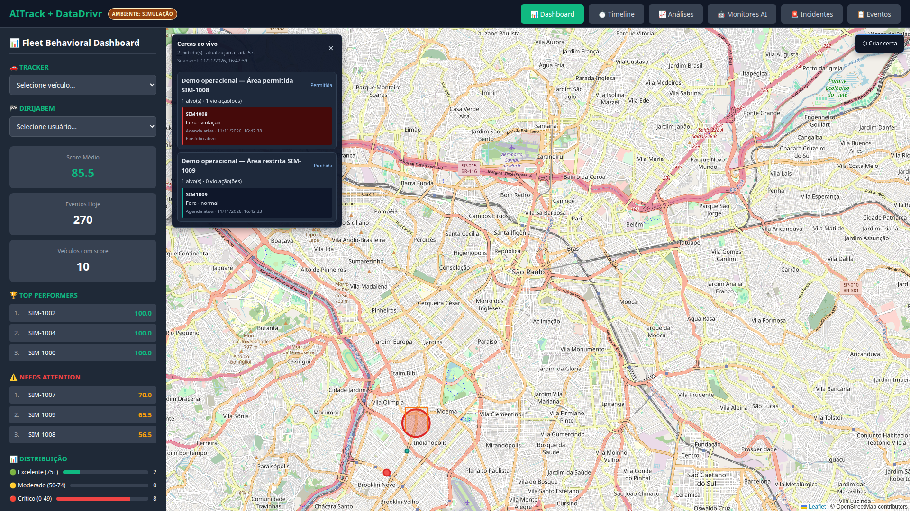
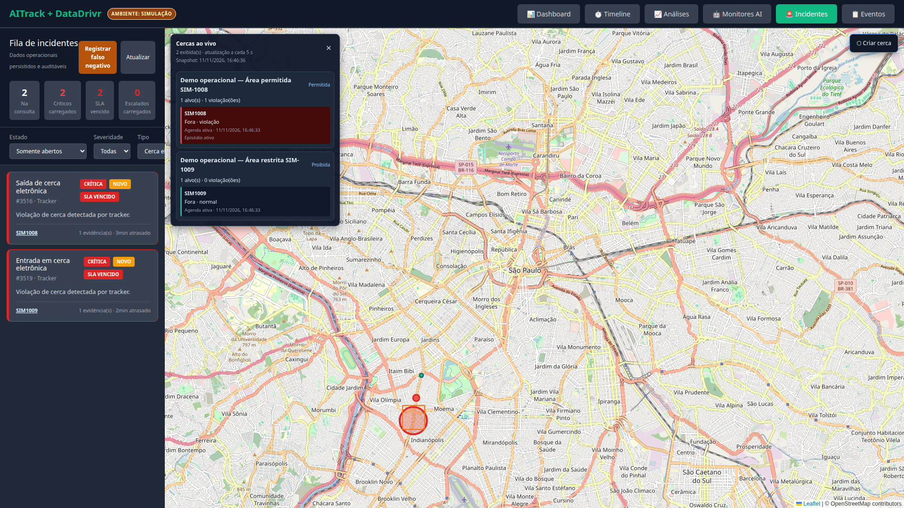

# Validação operacional de cercas eletrônicas

**Data/hora:** 11/11/2026, 16:46 (`America/Sao_Paulo`)  
**Ambiente:** simulação  
**Fontes ativas:** Tracker e Dirija Bem  
**Objetivo:** transformar o código de cercas existente em um fluxo comprovado e visível, sem confundir violação de cerca com monitoramento de roubo.

## Resultado esperado

1. Persistir uma cerca circular permitida e uma cerca poligonal proibida no banco operacional unificado `monitoramento`.
2. Vincular cada cerca a um veículo Tracker simulado.
3. Avaliar posições recebidas pelo socket, com estado dentro/fora e origem rastreável.
4. Abrir um episódio e um incidente crítico para cada violação.
5. Exibir as cercas no mapa e permitir filtrar os incidentes de cerca na fila operacional.

## Resultado obtido

Foram mantidas duas configurações operacionais, criadas deliberadamente para demonstração:

| Cerca | Geometria | Regra | Alvo | Resultado |
|---|---|---|---|---|
| Demo operacional — Área permitida SIM-1008 | círculo de 500 m | permitida: alerta ao sair | SIM-1008 | saída confirmada; episódio ativo; incidente `#3516` |
| Demo operacional — Área restrita SIM-1009 | polígono de quatro vértices | proibida: alerta ao entrar | SIM-1009 | entrada confirmada; episódio ativo; incidente `#3519` |

O círculo foi persistido com versão geométrica 1. O polígono foi ajustado por atualização otimista e ficou na versão geométrica 2, preservando a versão anterior.

Os incidentes foram correlacionados por `violation_episode_id`, com severidade crítica, uma evidência e uma entrada inicial de timeline cada. A origem registrada foi `tracker`.

## Melhoria implementada nesta rodada

A fila priorizava milhares de SLAs antigos e escondia os incidentes de cerca recém-criados. Foi adicionado o filtro `incident_type` ao endpoint `GET /api/incidents` e o seletor **Tipo** à interface, com a opção **Cerca eletrônica**.

Ao selecionar essa opção, a consulta retorna somente os dois incidentes operacionais de cerca, mantendo os filtros de estado e severidade combináveis.

## Evidências

### Mapa com cercas e estado ao vivo

### Fila filtrada por cerca eletrônica

### Testes

- 59 testes unitários específicos de geometria, API, motor, estado ao vivo e replay: aprovados.
- 242 testes completos do backend: aprovados; 12 integrações opt-in puladas.
- 65 testes completos do frontend: aprovados.
- TypeScript `npx tsc --noEmit`: aprovado.
- Build de produção do App 2: aprovado.
- Playwright em 1920×1080: duas cercas e dois incidentes visíveis; zero erro de página e zero resposta HTTP de erro.
- Runner de migrations: zero migrations pendentes.

## Limites e próximo passo

Esta entrega comprova cerca eletrônica, não roubo. Saída de área ou entrada em área proibida é um sinal de risco, mas pode ocorrer legitimamente.

O monitoramento de roubo deverá correlacionar, no mínimo, cerca, horário, autorização, ignição/alimentação quando o protocolo fornecer esses sinais, deslocamento/reboque, rota e confirmação por contato. Ele permanece pendente no bloco de sensores e segurança patrimonial.

As duas cercas de demonstração foram preservadas intencionalmente no banco `monitoramento`, identificadas por `owner_ref = demo-operacional-codex-20261111`.
