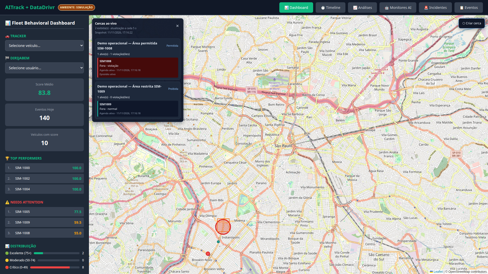
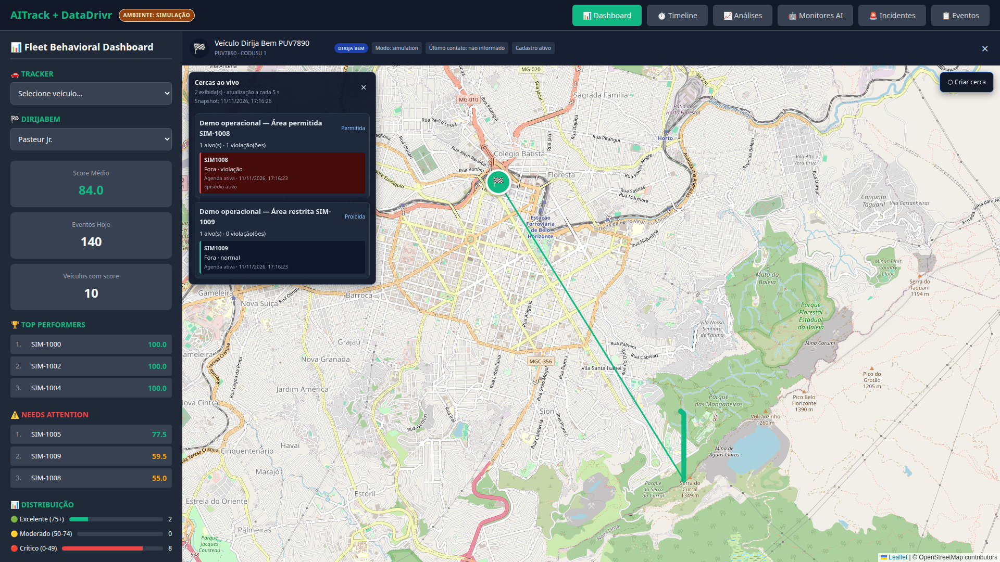
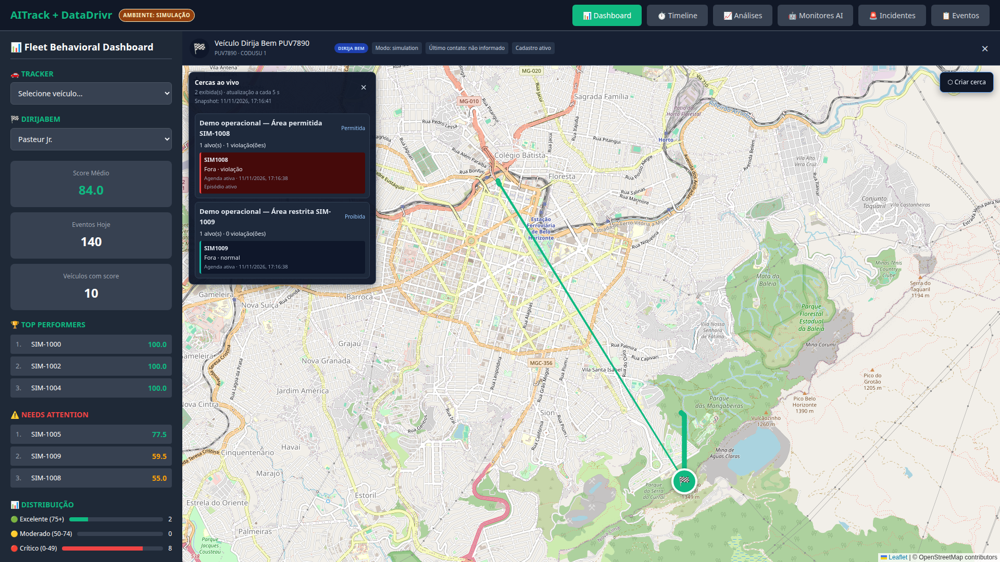
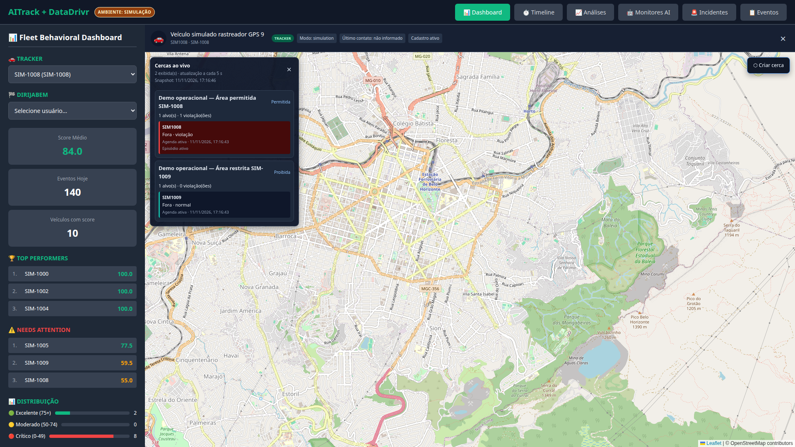
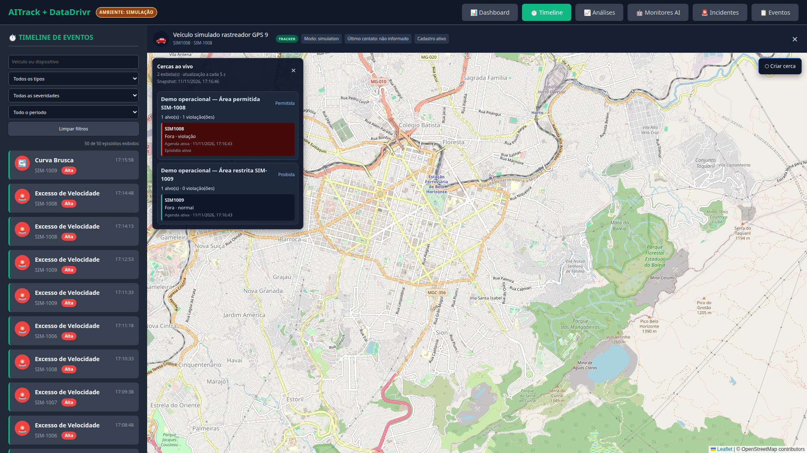
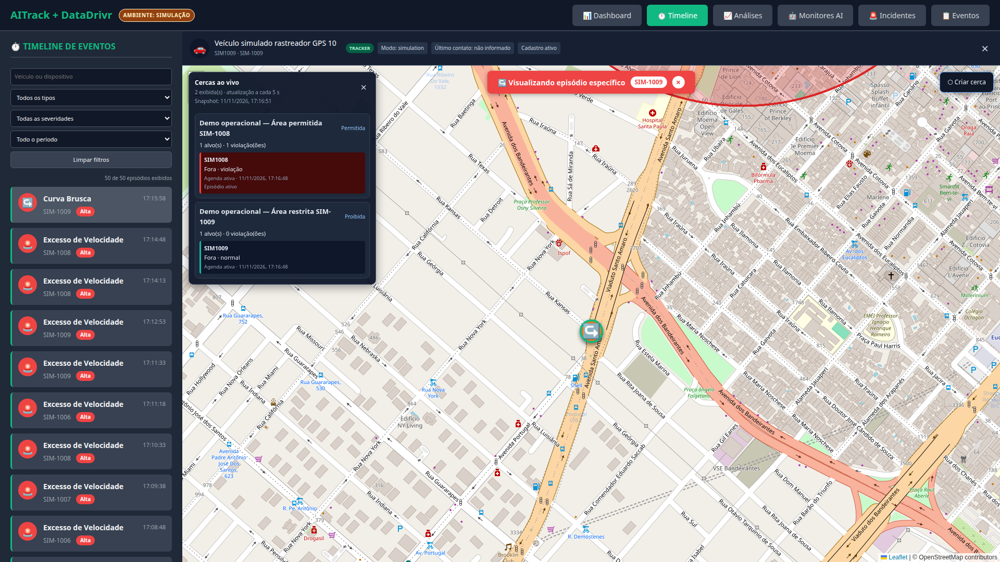
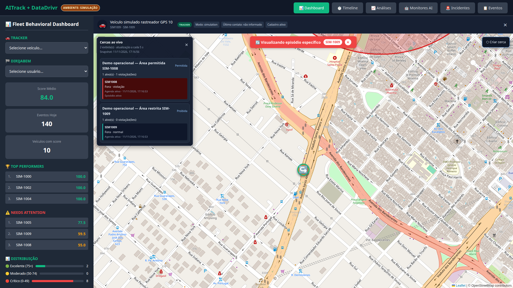
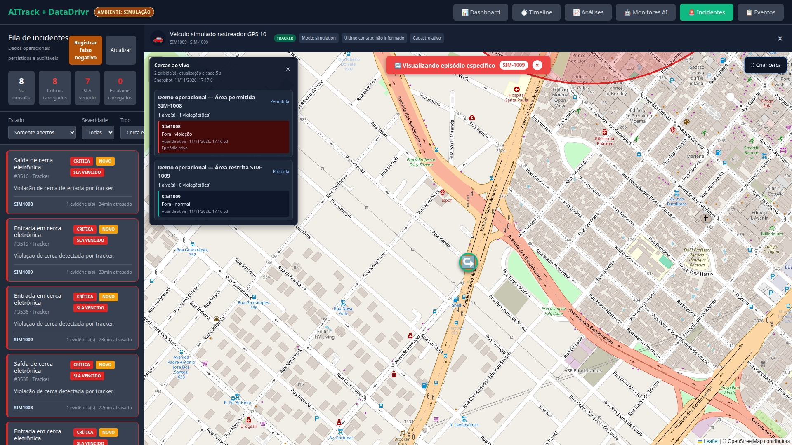
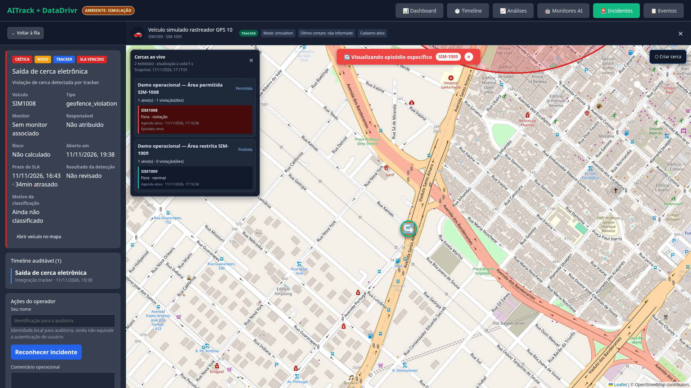
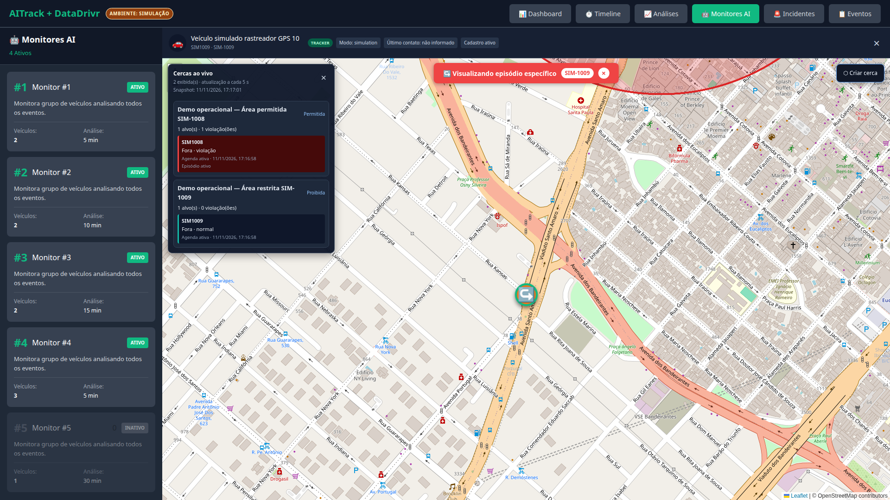

# Roteiro de apresentação — Plataforma Integrada de Monitoramento Veicular

**Duração-alvo:** 5 minutos  
**Formato:** demonstração narrada, 1920 × 1080, com a aplicação em execução  
**Fontes demonstradas:** Dirija Bem e Tracker  
**Data das evidências:** 11/11/2026

## Orientação de produção

- Grave a aplicação em tela cheia e mantenha o cursor visível, sem movimentos bruscos.
- Use zoom editorial entre 110% e 125% apenas nos elementos indicados por **Destaque**.
- Aplique uma moldura amarela fina, com animação de entrada de 250 ms, nos campos mencionados.
- Nas trocas de tela, use corte simples ou dissolução de no máximo 300 ms.
- Não esconda a identificação da origem dos dados: **Dirija Bem** e **Tracker** são parte central da demonstração.
- Os dados demonstrados são **sintéticos, gerados pelos simuladores e persistidos no banco**. Eles não são valores estáticos criados no front-end.
- A locução abaixo pode ser lida literalmente. As instruções em itálico não devem ser narradas.

## 1. Visão integrada da operação — 00:00 a 00:25

**Ação na tela:** iniciar no dashboard, aguardar o carregamento dos marcadores e mover lentamente o cursor pela barra superior, mapa e painel lateral.

**Destaque:** aplicar primeiro uma moldura no seletor de origem; depois, destacar os indicadores operacionais e as cercas listadas no painel.

**Narração:**

> Esta é a visão integrada da plataforma. Em uma única interface, o operador acompanha veículos do Dirija Bem e do Tracker, preservando a origem de cada informação. Mapa, eventos e cercas usam dados gerados pelos simuladores e registrados no banco — não conteúdo fixo criado na interface.

**Resultado que a cena comprova:** as duas fontes estão disponíveis no mesmo painel operacional.

## 2. Veículo Dirija Bem selecionado — 00:25 a 00:55

**Ação na tela:** selecionar a origem Dirija Bem e o motorista **Pasteur Jr.**; manter o cursor sobre a identificação **PUV7890 / CODUSU 1** e, em seguida, percorrer visualmente a rota no mapa.

**Destaque:** ampliar a identificação do motorista, a placa/código do veículo e o selo de origem. Depois, desenhar uma linha luminosa curta acompanhando o trajeto exibido.

**Narração:**

> Agora selecionamos um registro produzido pelo simulador do Dirija Bem. O motorista Pasteur Jr. está associado ao veículo PUV7890, também identificado como CODUSU 1. A aplicação consulta as posições persistidas e reconstrói a rota. O monitor identifica quem dirige, qual veículo está em operação, a origem do dado e o caminho percorrido.

**Resultado que a cena comprova:** identificação, origem e histórico de posições do Dirija Bem aparecem correlacionados.

## 3. Atualização do deslocamento — 00:55 a 01:20

**Ação na tela:** fazer uma transição comparativa entre a captura anterior e esta. Se o vídeo for gravado ao vivo, aguardar uma nova atualização e apontar a mudança do marcador.

**Destaque:** usar um círculo pulsante na posição anterior por um segundo e outro na posição atual. Exibir discretamente a legenda **“nova posição recebida”**.

**Narração:**

> Alguns segundos depois, uma nova posição é recebida e o marcador avança. O veículo não está apenas animado no navegador: o simulador gera a telemetria, o banco recebe o dado e a tela consulta a atualização. Esse fluxo sustenta o cálculo de deslocamento, permanência e cruzamento de regiões.

**Resultado que a cena comprova:** duas capturas distintas da mesma viagem apresentam atualização visual da posição.

## 4. Segunda fonte: Tracker — 01:20 a 01:45

**Ação na tela:** trocar o seletor para Tracker, selecionar o veículo disponível e aguardar a centralização do mapa.

**Destaque:** moldura no seletor **Tracker**, na identificação do veículo e no horário da última posição.

**Narração:**

> A operação também recebe veículos do Tracker. Ao trocar a origem, a interface apresenta a identidade e a posição mais recente do ativo. A unificação não apaga a procedência: cada registro continua rastreável até seu sistema de origem, dentro da mesma experiência operacional.

**Resultado que a cena comprova:** o Tracker participa do painel unificado sem perder sua identificação de origem.

## 5. Timeline de eventos — 01:45 a 02:10

**Ação na tela:** abrir a timeline, percorrer os filtros sem alterá-los e parar sobre dois eventos diferentes.

**Destaque:** destacar tipo, gravidade, veículo, origem e horário de um evento.

**Narração:**

> As posições alimentam uma timeline operacional. Os eventos podem ser filtrados por tipo, gravidade, veículo e origem. Cada item preserva horário e associação com o ativo. Assim, a operação transforma pontos no mapa em fatos que podem ser investigados, priorizados e auditados.

**Resultado que a cena comprova:** eventos persistidos são consultáveis e possuem contexto operacional.

## 6. Evento correlacionado ao mapa — 02:10 a 02:35

**Ação na tela:** clicar em um evento da timeline e aguardar o mapa reposicionar. Manter o cursor primeiro no item selecionado e depois no marcador correspondente.

**Destaque:** ligar visualmente o cartão do evento ao ponto do mapa com uma seta discreta.

**Narração:**

> Ao selecionar um evento, a aplicação o correlaciona ao veículo e à localização. O monitor passa da lista para a evidência geográfica com um clique. Essa ligação reduz o tempo de análise e prepara decisões futuras do agente automático, considerando posição, histórico, severidade e contexto.

**Resultado que a cena comprova:** evento, veículo e localização estão relacionados na interface.

## 7. Cercas eletrônicas operacionais — 02:35 a 03:10

**Ação na tela:** abrir o painel de cercas; apontar uma cerca circular e uma poligonal, seus alvos e estados. Se a gravação ao vivo enquadrar a geometria, usar zoom no mapa; caso contrário, manter o foco na lista operacional.

**Destaque:** moldura alternada nos rótulos **circular** e **poligonal**, no estado habilitado e no contador de violações.

**Narração:**

> O módulo de cercas já trabalha com geometrias circulares e poligonais. Cada cerca possui configuração, estado e veículos associados. Quando um alvo cruza o limite, o sistema registra entrada ou saída e gera informação operacional. Aqui mostramos o estado das cercas; a ferramenta de desenho e edição visual ainda será ampliada.

**Resultado que a cena comprova:** cercas dos dois formatos estão cadastradas e avaliadas; o editor completo ainda é uma evolução planejada.

## 8. Incidentes de entrada e saída — 03:10 a 03:40

**Ação na tela:** abrir a fila de incidentes e aplicar o filtro **Cerca eletrônica**. Percorrer registros de saída e entrada sem alterar o estado deles.

**Destaque:** destacar um incidente de saída, um de entrada, a severidade, o estado e o indicador de SLA.

**Narração:**

> A violação não termina em um aviso. Entradas e saídas geram incidentes persistidos, com severidade, estado e controle de prazo. Uma saída de cerca é um sinal de risco, mas não prova roubo. Essa conclusão exigirá correlação com autorização, horário, ignição, rota e contato com o responsável.

**Resultado que a cena comprova:** violações de cerca chegam à fila operacional; detecção conclusiva de roubo ainda não é alegada.

## 9. Evidência auditável do incidente — 03:40 a 04:05

**Ação na tela:** abrir o detalhe de um incidente e rolar somente o necessário para mostrar identificação, contexto e evidências disponíveis.

**Destaque:** ampliar o título do incidente, veículo, origem, horário e evidência geográfica; não clicar em ações destrutivas ou de alteração de estado.

**Narração:**

> No detalhe, o operador encontra veículo, origem, momento e evidências do incidente. Esse registro é essencial para auditoria e para reduzir falsos positivos e negativos. Uma automação segura precisa justificar sua classificação e manter o histórico das decisões e ações executadas.

**Resultado que a cena comprova:** o incidente possui contexto consultável para análise e auditoria.

## 10. Monitores e evolução para agentes autônomos — 04:05 a 04:45

**Ação na tela:** abrir a tela de monitores e percorrer a lista. Apontar estado, intervalo de execução e quantidade de veículos de cada monitor.

**Destaque:** destacar os quatro monitores ativos, o monitor inativo, o intervalo e a quantidade de veículos. Sobrepor, durante a segunda metade da cena, o fluxo: **detectar → contextualizar → decidir → agir → acompanhar → escalar**.

**Narração:**

> Os monitores persistidos executam regras com estado, intervalo e veículos definidos. A próxima evolução acrescenta modelo de linguagem e políticas de segurança para reproduzir o ciclo humano: detectar, contextualizar, decidir dentro de limites, enviar mensagem, pedir confirmação, atualizar o incidente, acompanhar a resposta e escalar para ligação ou operador. Hoje comprovamos os monitores; mensageria, chamadas e decisões autônomas ainda não estão concluídas.

**Resultado que a cena comprova:** os monitores estão configurados e operacionais; autonomia com LLM e canais externos permanece como próxima camada.

## 11. Encerramento — 04:45 a 05:00

**Imagem:** reutilizar `01_abertura_dashboard.png` com zoom lento de 100% para 108%.

**Ação na tela:** voltar ao dashboard e encerrar com o mapa, indicadores e as duas origens visíveis.

**Destaque:** sobrepor três frases curtas: **duas fontes integradas**, **eventos e cercas persistidos**, **base preparada para agentes autônomos**.

**Narração:**

> A plataforma integra Dirija Bem e Tracker, transforma telemetria em eventos e incidentes e avalia cercas eletrônicas. O próximo salto é automatizar a resposta com agentes auditáveis, canais de contato e limites claros. Esta é a fundação de uma central de monitoramento contínua e segura.

## Checklist antes da gravação definitiva

- Backend, front-end e os dois simuladores em execução.
- Ao menos um veículo Dirija Bem com duas atualizações recentes de posição.
- Ao menos um veículo Tracker visível e identificado.
- Timeline com eventos persistidos.
- Cercas circular e poligonal cadastradas e habilitadas.
- Incidentes de entrada e saída disponíveis no filtro de cerca eletrônica.
- Tela de monitores carregando dados do backend.
- Nenhuma afirmação de que chamadas, mensagens, LLM ou detecção conclusiva de roubo já estejam em produção.

## Evidências da captura

- Resolução: 1920 × 1080.
- Quantidade de telas: 10.
- Erros de página registrados durante a captura: 0.
- Erros HTTP registrados durante a captura: 0.
- As duas capturas do veículo Dirija Bem possuem conteúdo visual distinto, evidenciando atualização entre ciclos.

