# Roteiro de demonstração e validação — AITrack + DataDrivr

**Versão:** 1.0  
**Data da validação:** 11/11/2026  
**Duração recomendada:** 18 a 22 minutos  
**Versão condensada:** aproximadamente 10 minutos  
**Ambiente capturado:** simulação, com dados sintéticos persistidos pelos simuladores Tracker e Dirija Bem  
**Resolução das capturas:** 1920 × 1080

## 1. Objetivo do vídeo

Este vídeo deve demonstrar o que existe de fato na aplicação, usando a execução real do back-end, do front-end e dos dois simuladores. A gravação não deve apresentar dados de interface inventados nem esconder limitações encontradas. Ela deve provar o fluxo atualmente validado entre telemetria, mapa, eventos, análises, monitores e incidentes. Cercas eletrônicas e monitoramento de roubo ainda não fazem parte do fluxo funcional validado.

O material também serve como validação do estado atual do produto. Sempre que um comportamento estiver incompleto ou inconsistente, o narrador deve identificá-lo como pendência, sem tratá-lo como recurso concluído.

## 2. Estado validado antes da gravação

- API Flask em `http://localhost:5009`.
- receptor de telemetria Tracker na porta `9000`.
- front-end em `http://localhost:3000`.
- simulador Tracker enviando 10 veículos, de `SIM-1000` a `SIM-1009`.
- simulador Dirija Bem persistindo viagens e posições sintéticas no banco.
- seis áreas visíveis: Dashboard, Timeline, Análises, Monitores AI, Incidentes e Eventos.
- 17 capturas Playwright geradas sem erro JavaScript e sem resposta HTTP 4xx/5xx durante a rodada final.

Os números exibidos mudam enquanto os simuladores estão ativos. Na captura de referência havia 10 veículos Tracker com score, 22 eventos do dia e 5 monitores cadastrados, dos quais 4 estavam ativos.

## 3. Regras de produção

1. Grave em 1920 × 1080, com zoom do navegador em 100%.
2. Mantenha o selo **AMBIENTE: SIMULAÇÃO** visível sempre que possível.
3. Antes de clicar, deixe o cursor parado por aproximadamente um segundo sobre o controle.
4. Após cada mudança de tela, aguarde o mapa e os dados estabilizarem.
5. Não leia identificadores e contagens como valores fixos; diga “na execução atual” ou “nesta captura”.
6. Use realce de cursor ou zoom editorial apenas para chamar atenção a um elemento existente.
7. Não chame os monitores atuais de agentes autônomos baseados em modelo de linguagem. Eles são monitores operacionais persistidos e orientados por regras.
8. Não afirme que ligações, WhatsApp, SMS ou e-mail automáticos já estão implementados.
9. Não apresente a tela preliminar de cercas como recurso implementado. Ela é somente uma proposta visual em desenvolvimento.
10. Não afirme que existe monitoramento, confirmação ou protocolo automatizado de roubo.

## 4. Abertura e prova da execução — 00:00 a 01:10

### Imagem de apoio

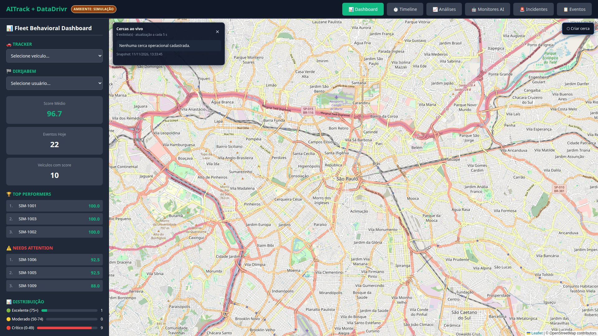

### Ação de gravação

Comece com um plano curto dos terminais, mostrando o back-end nas portas 5009 e 9000, o simulador Tracker transmitindo os dez dispositivos e o simulador Dirija Bem avançando nas viagens. Corte para o Dashboard e pare o cursor sobre o selo de simulação.

### Narração

> Esta é a aplicação AITrack mais DataDrivr em execução integrada. O ambiente está explicitamente marcado como simulação. Um simulador representa dispositivos Tracker, transmitindo telemetria pela porta 9000, e outro representa o ecossistema Dirija Bem, persistindo viagens e posições sintéticas no banco. A interface consulta a API real; portanto, o que veremos não é uma coleção de cards mockados, mas dados gerados, armazenados e recuperados pelo sistema.

### Evidência esperada

- selo de ambiente visível;
- mapa carregado;
- contadores e rankings preenchidos;
- menu com as seis áreas do produto.

## 5. Dashboard e visão operacional — 01:10 a 02:20

### Imagem de apoio

### Ação de gravação

Percorra lentamente a lateral esquerda: seletores Tracker e Dirija Bem, score médio, eventos do dia, quantidade de veículos, melhores resultados, veículos que precisam de atenção e distribuição. Não destaque o painel preliminar de cercas como função operacional.

### Narração

> O Dashboard concentra a supervisão da frota. Os dois seletores preservam a origem da informação: Tracker para os equipamentos de rastreamento e Dirija Bem para os usuários e viagens desse banco. Os indicadores resumem score comportamental e eventos detectados. Os rankings ajudam o operador a priorizar quem está em melhor condição e quem requer atenção. O mapa é atualmente usado para trajetos, eventos e incidentes.

> Há uma inconsistência que esta validação deixa registrada: os scores mostrados estão na faixa alta, mas a distribuição lateral classifica a maior parte da frota como crítica. Esse cálculo precisa ser corrigido antes de a distribuição ser usada como indicador operacional.

### Resultado observado

O Dashboard carregou e atualizou dados. A distribuição de score apresentou resultado incompatível com os scores individuais. Os controles preliminares de cercas não foram considerados funcionalidade pronta.

## 6. Rastreamento de um veículo Tracker — 02:20 a 03:30

### Imagem de apoio

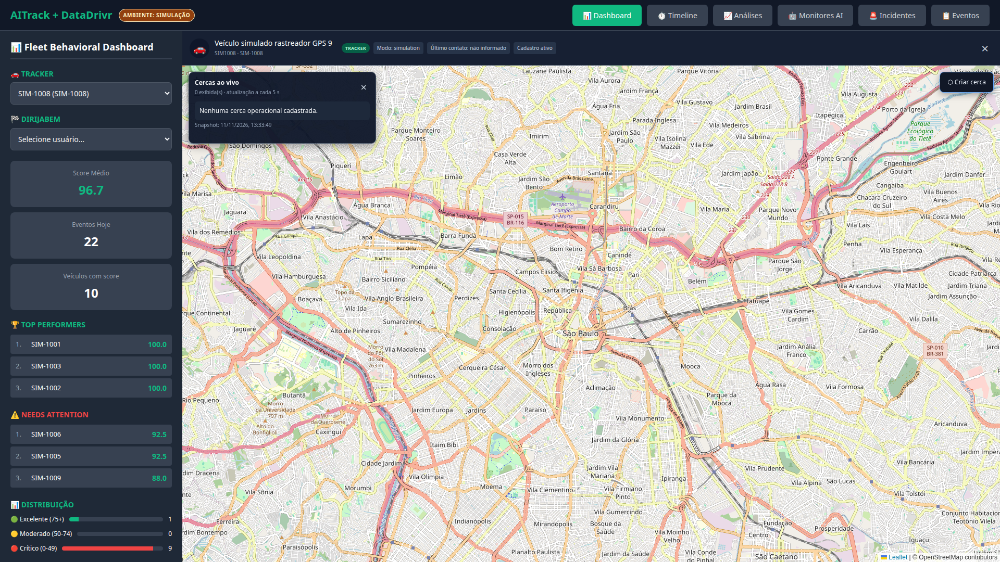

### Ação de gravação

Abra o seletor Tracker e escolha `SIM-1008`. Aguarde a faixa contextual aparecer no topo. Aponte para o nome, origem Tracker, modo de simulação e estado cadastral. Mostre a centralização do mapa.

### Narração

> Ao selecionar um equipamento Tracker, a aplicação abre o contexto daquele veículo e preserva sua identidade de origem. A faixa superior diferencia o cadastro Tracker, informa o modo operacional e concentra os metadados do ativo. O mapa passa a trabalhar no contexto selecionado, permitindo acompanhar a posição e correlacionar o veículo com eventos e incidentes.

> Nesta versão, o campo de último contato aparece como não informado. Esse dado deve ser normalizado para que a operação consiga distinguir um veículo ativo de um dispositivo silencioso.

### Resultado observado

Seleção e identificação Tracker funcionaram. A telemetria foi recebida pelo receptor e persistida. O último contato ainda não está preenchido na faixa contextual.

## 7. Viagem Dirija Bem — 03:30 a 04:40

### Imagem de apoio

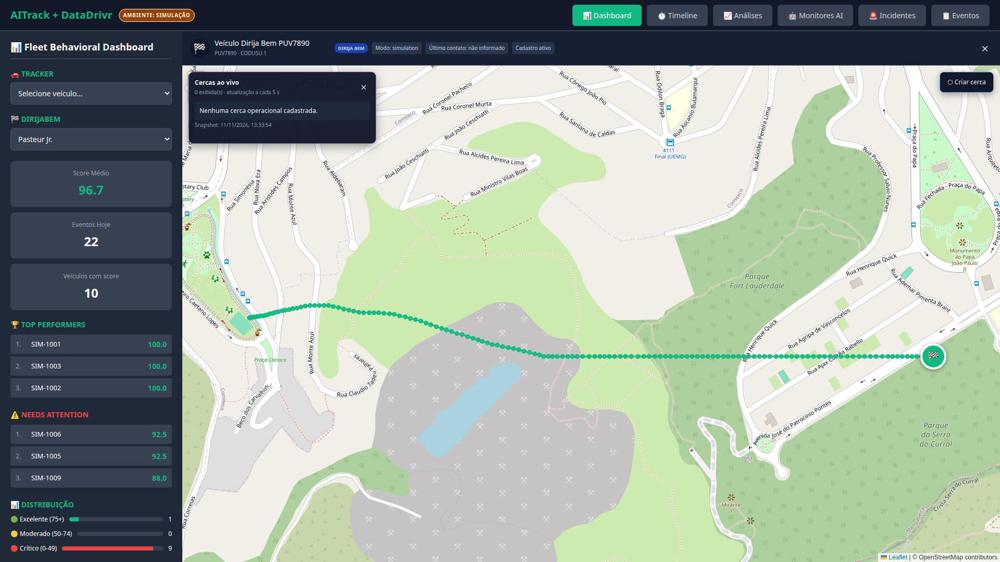

### Ação de gravação

Limpe a seleção Tracker e escolha o usuário Dirija Bem da demonstração. Aguarde o mapa enquadrar a rota. Percorra com o cursor a linha do trajeto, o marcador final e a faixa superior.

### Narração

> A segunda origem é o Dirija Bem. Aqui selecionamos um usuário cuja viagem sintética foi gravada no banco pelo simulador contínuo. A linha verde não é desenhada estaticamente na interface: ela representa as posições persistidas para a viagem. A faixa superior muda a origem para Dirija Bem e apresenta a identidade vinculada ao usuário e ao veículo.

> No produto final, abrir ou retomar uma viagem deve ser uma ação claramente sinalizada, porque o seletor pode provocar uma mudança operacional e não apenas uma consulta visual.

### Resultado observado

O trajeto Dirija Bem foi recuperado e desenhado no mapa, com diferenciação visual da origem.

## 8. Identidade e frota unificada — 04:40 a 05:25

### Imagem de apoio

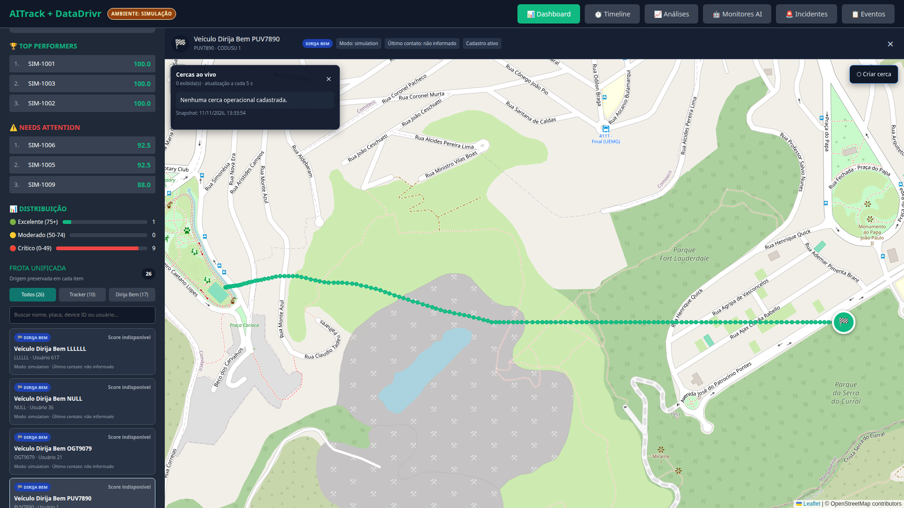

### Ação de gravação

Role a lateral até “Frota unificada”. Mostre que cada item conserva origem e identificadores, sem afirmar que registros semelhantes já foram deduplicados automaticamente.

### Narração

> A frota unificada cria uma visão comum sem apagar a procedência dos dados. Isso é importante porque Tracker e Dirija Bem possuem identificadores e ciclos operacionais diferentes. A camada unificada deve correlacionar essas identidades, preservar rastreabilidade e impedir que o mesmo ativo apareça como duas entidades operacionais sem explicação.

### Resultado observado

A interface apresenta as origens em uma visão comum. A consolidação definitiva de identidade ainda precisa ser validada com dados reais dos dois bancos.

## 9. Timeline de eventos — 05:25 a 06:55

### Imagens de apoio

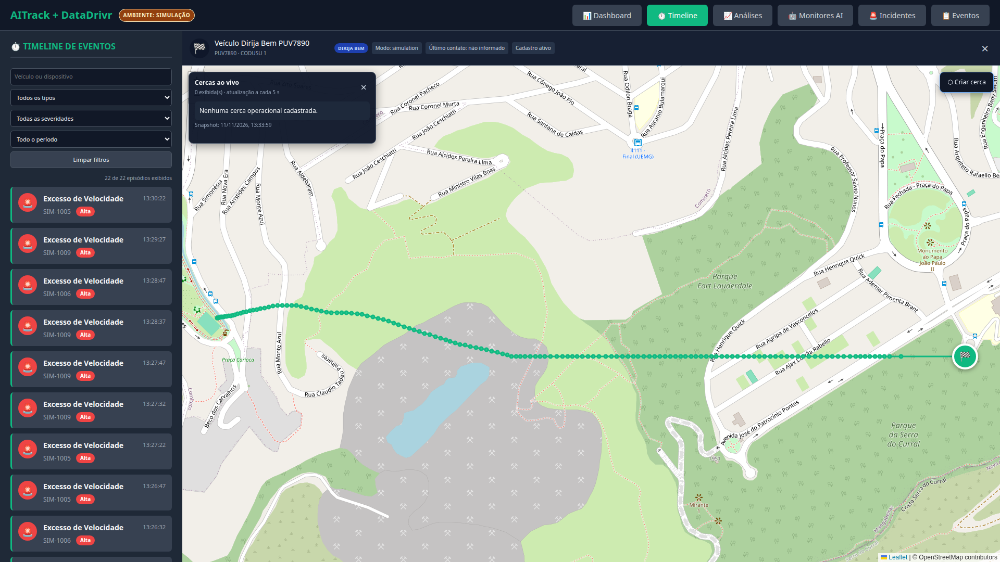

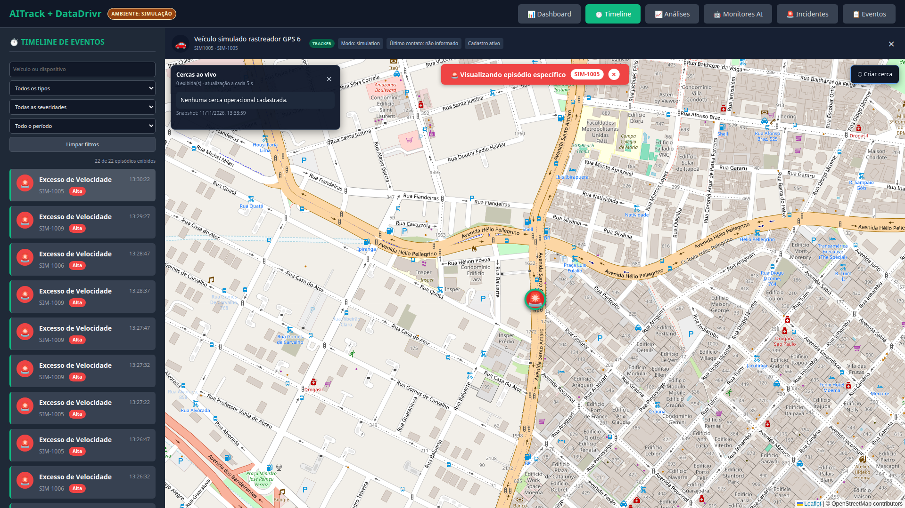

### Ação de gravação

Abra Timeline. Mostre pesquisa por veículo, filtros de tipo, severidade e período. Escolha um evento recente e mostre a correlação com o mapa e a faixa de episódio específico.

### Narração

> A Timeline organiza episódios detectados pelos dados persistidos. O operador pode restringir a busca por ativo, tipo, severidade e janela de tempo. Nesta execução, o simulador gerou episódios de excesso de velocidade. Ao selecionar um item, a interface leva o contexto ao mapa e identifica o veículo associado. Essa ligação entre lista, evidência temporal e posição é a base para investigar um evento sem perder sua origem.

### Resultado observado

Os filtros foram exibidos, eventos persistidos apareceram na lista e a seleção atualizou o contexto do mapa.

## 10. Análises comportamentais — 06:55 a 08:05

### Imagem de apoio

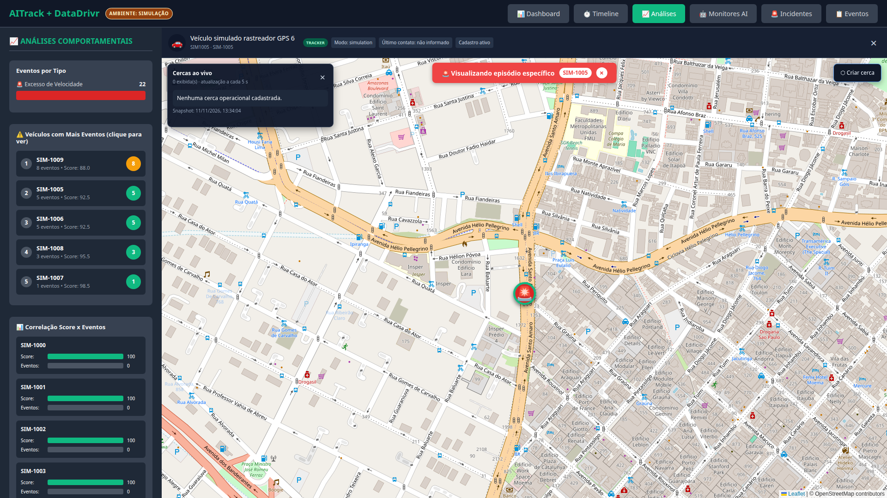

### Ação de gravação

Abra Análises. Aponte para eventos por tipo, ranking de veículos e correlação entre score e eventos. Clique em um veículo do ranking para mostrar a contextualização no mapa.

### Narração

> A área de Análises transforma os eventos em uma leitura de comportamento da frota. Ela mostra a distribuição por tipo, ordena os veículos mais afetados e compara quantidade de eventos com score. O clique em um item do ranking abre a posição correspondente. Na amostra atual, o excesso de velocidade domina porque é o evento produzido nesta janela dos simuladores; isso não significa que os demais detectores estejam sendo exercitados nesta gravação.

### Resultado observado

Ranking, contagens, score e seleção contextual funcionaram com os dados da execução.

## 11. Monitores operacionais — 08:05 a 09:40

### Imagens de apoio

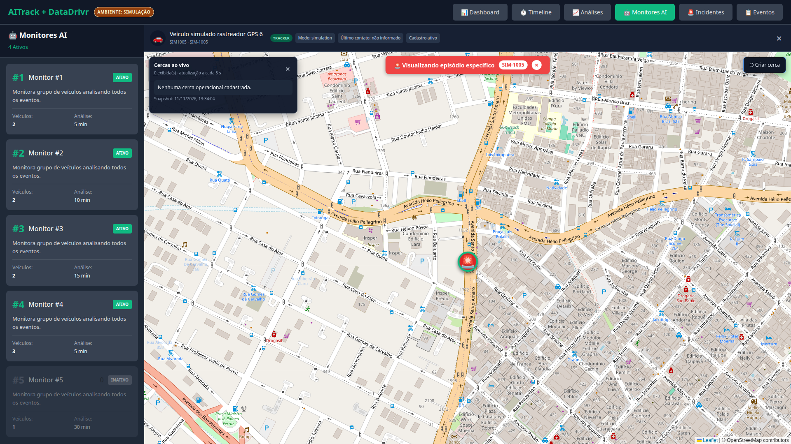

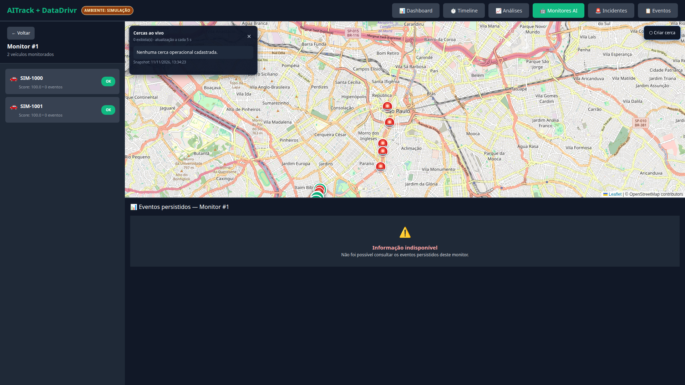

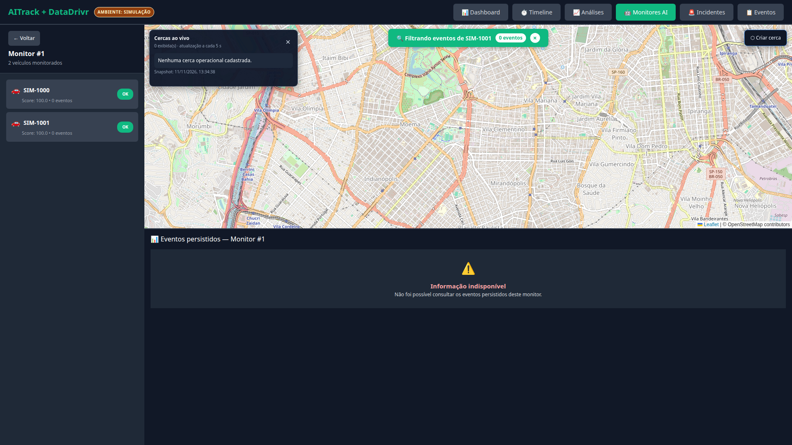

### Ação de gravação

Abra Monitores AI e percorra os cinco registros. Destaque estado, número de veículos e intervalo de análise. Abra o Monitor #1 e mostre os veículos vinculados. Não corte a mensagem de indisponibilidade da consulta de eventos; use-a para explicar a pendência.

### Narração

> Existem cinco monitores persistidos; quatro estão ativos e um está inativo. Cada registro define um grupo de veículos e um intervalo de análise. Ao abrir um monitor, vemos os ativos atribuídos e o mapa compartilhado.

> Apesar do nome Monitores AI na interface, esta camada ainda não possui um modelo de linguagem tomando decisões autônomas. Hoje ela representa monitores operacionais orientados por regras e dados persistidos. A evolução para um agente semelhante a um operador humano ainda exige motor de decisão, políticas, memória, ferramentas de contato, aprovação, limites e auditoria.

> Esta gravação também encontrou uma falha reproduzível: a consulta dos eventos persistidos do Monitor #1 excedeu o tempo disponível e a tela apresentou informação indisponível. Os endpoints respondem, mas a consulta ao histórico volumoso precisa ser paginada e otimizada. Portanto, a lista e os vínculos estão demonstrados; o painel de eventos do monitor não deve ser apresentado como concluído.

### Resultado observado

Lista, estados, intervalos e vínculos carregaram. A consulta detalhada de eventos falhou por timeout/lentidão sob a carga atual.

## 12. Fila de incidentes e SLA — 09:40 a 11:10

### Imagem de apoio

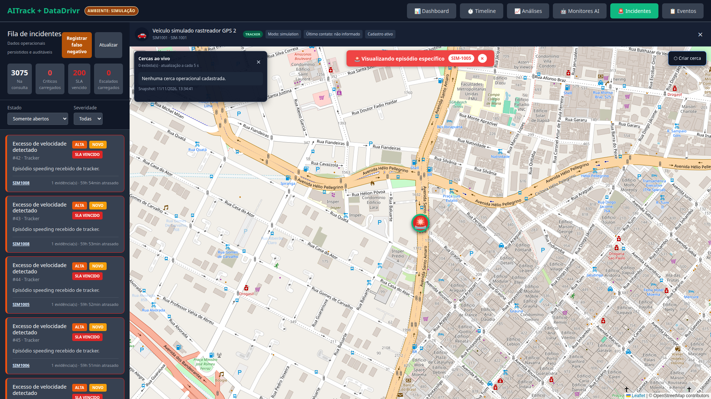

### Ação de gravação

Abra Incidentes. Mostre totais, críticos, SLA vencido e escalados. Passe pelos filtros de estado e severidade. Abra um incidente recente, evitando sugerir que toda a fila histórica foi tratada.

### Narração

> A fila de incidentes é a camada operacional acima dos eventos. Um evento é uma ocorrência de telemetria; um incidente é um caso que precisa de tratamento, estado, prazo, evidência e responsabilização. A interface mostra volume total, criticidade, SLA vencido e escalonamentos, além de permitir filtrar por estado e severidade.

> O ambiente de desenvolvimento acumulou mais de três mil incidentes históricos e centenas com SLA vencido. Esse volume demonstra persistência, mas não representa uma operação saneada. Antes de uma demonstração comercial, a massa deve ser separada por execução ou campanha, sem apagar o histórico auditável.

### Resultado observado

Fila, filtros, marcadores de severidade e SLA foram carregados. O acúmulo histórico prejudica a leitura e precisa de paginação/curadoria.

## 13. Detalhe, evidência e auditoria — 11:10 a 12:35

### Imagem de apoio

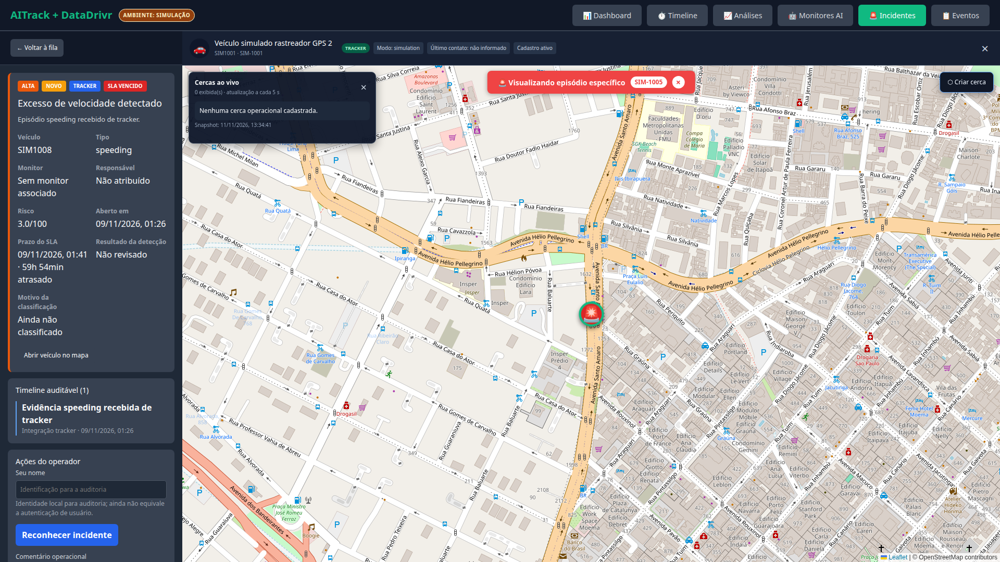

### Ação de gravação

No incidente aberto, percorra título, origem, severidade, veículo, mapa, evidências, risco, SLA e timeline auditável. Se houver controles de transição, apenas explique-os; não altere um caso histórico durante a gravação.

### Narração

> O detalhe reúne o contexto necessário para uma decisão operacional: qual evento abriu o caso, qual ativo está envolvido, onde ocorreu, qual é a gravidade, qual prazo está em vigor e quais evidências sustentam a ocorrência. A timeline auditável deve registrar cada transição e o operador responsável.

> O nome do operador nesta versão funciona como identidade de auditoria informada pela interface; ele ainda não equivale a autenticação, autorização ou assinatura forte. Para operação real, as ações devem estar ligadas a usuários autenticados e perfis de permissão.

### Resultado observado

O caso abriu com contexto geográfico e estrutura auditável. Autenticação e autorização ainda não estão demonstradas.

## 14. Registro de falso negativo — 12:35 a 13:45

### Imagem de apoio

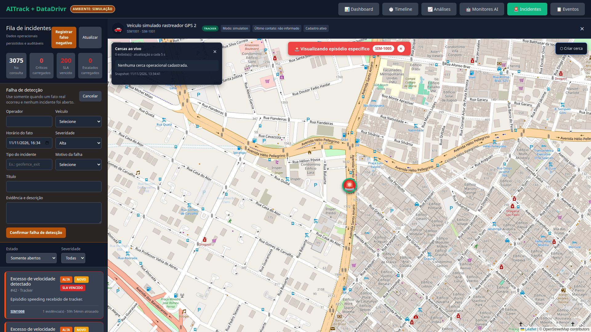

### Ação de gravação

Volte à fila, clique em “Registrar falso negativo” e percorra operador, veículo, horário, severidade, tipo, motivo, título e evidência. Não confirme o formulário durante o vídeo.

### Narração

> Um sistema de detecção precisa registrar tanto falsos positivos quanto falsos negativos. Este formulário cobre o segundo caso: um fato real ocorreu, mas nenhum incidente foi aberto. O operador informa ativo, momento, severidade, tipo esperado, causa provável e evidência. Esse retorno deve alimentar avaliação dos detectores e, futuramente, as métricas de qualidade dos agentes.

> O registro por si só não prova que o aprendizado automático já exista. Hoje ele cria uma base auditável para análise e melhoria posterior.

### Resultado observado

O formulário abriu com os campos operacionais previstos. Nenhum dado de teste foi gravado durante a captura.

## 15. Catálogo operacional de eventos — 13:45 a 15:05

### Imagens de apoio

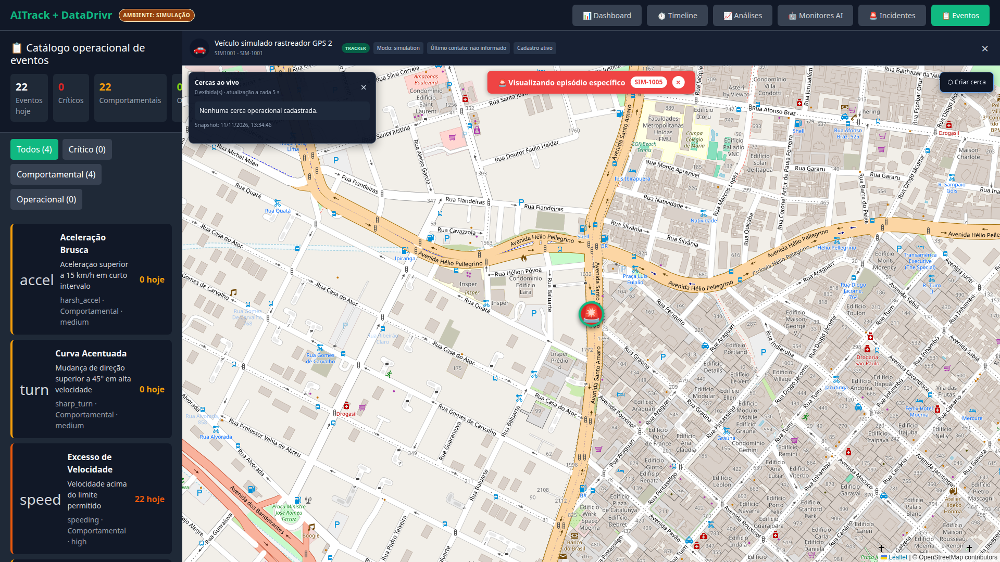

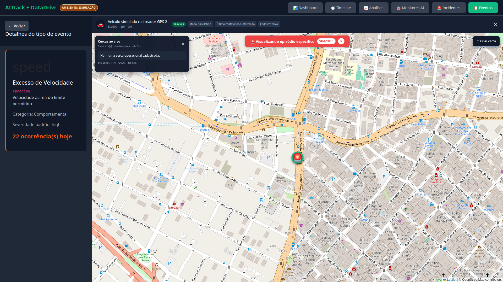

### Ação de gravação

Abra Eventos. Mostre totais e filtros por categoria. Percorra os quatro tipos suportados e abra Excesso de Velocidade. Destaque código, categoria, severidade e ocorrências do dia.

### Narração

> O catálogo declara os tipos de evento que o produto conhece e mostra quais deles realmente tiveram ocorrências na janela atual. Nesta execução existem quatro detectores comportamentais cadastrados: aceleração brusca, curva acentuada, excesso de velocidade e o quarto tipo disponível na lista. O excesso de velocidade possui ocorrências geradas pelos simuladores; os tipos com zero não devem ser confundidos com falha, mas também não podem ser considerados validados por esta sessão.

> Ao abrir um tipo, a interface mostra sua definição operacional e a contagem observada. Para uma validação completa, cada detector precisa de cenários positivos, negativos e de fronteira, incluindo medição de falsos positivos e falsos negativos.

### Resultado observado

O catálogo e o detalhe foram carregados a partir da API. Excesso de velocidade tinha ocorrências; os demais tipos não foram exercitados pela janela capturada.

## 16. Protótipo visual de cerca circular — funcionalidade futura — 15:05 a 15:45

### Imagem de apoio

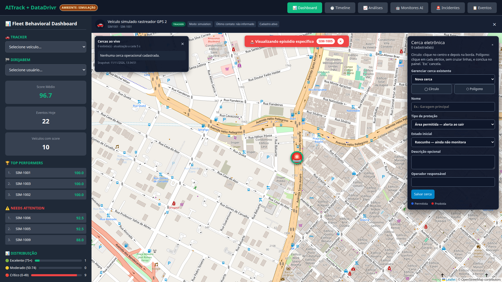

### Ação de gravação

Se esta tela for incluída no vídeo, exiba-a somente como protótipo visual do que ainda será implementado. Não desenhe, salve ou simule uma cerca como se o fluxo estivesse pronto.

### Narração

> Esta tela é uma proposta visual para a futura criação de cercas circulares. Ela indica campos e interações desejadas, mas ainda não constitui uma funcionalidade concluída. Não estão validados desenho, persistência, versionamento, vínculo com veículos, avaliação de posição, entrada, saída, abertura de incidente ou notificação.

### Resultado observado

A interface preliminar abriu e apresentou campos. Nenhum comportamento funcional de cerca foi validado.

## 17. Protótipo visual de cerca poligonal — funcionalidade futura — 15:45 a 16:25

### Imagem de apoio

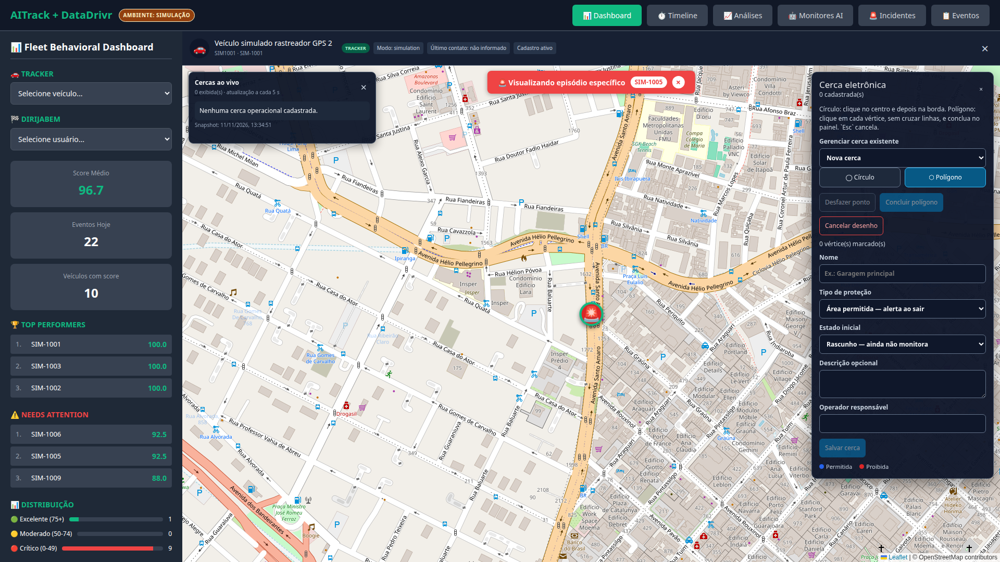

### Ação de gravação

Mostre apenas que o protótipo prevê um modo poligonal. Os controles visíveis representam o desenho desejado para a interface, não uma definição de polígono validada.

### Narração

> O planejamento futuro prevê cercas poligonais para garagens, corredores, bairros, pátios e outras áreas irregulares. Ainda será necessário definir e implementar desenho por vértices, validação geométrica, persistência no banco operacional unificado, versionamento, atribuições a alvos Tracker e Dirija Bem e avaliação operacional.

> Todo o ciclo ainda é futuro: salvar, ativar, vincular veículos das duas origens, detectar entrada ou saída, abrir incidente, notificar e preservar a versão geométrica usada na decisão.

### Resultado observado

A proposta visual do modo poligonal foi capturada. Nenhuma funcionalidade de polígono ou violação foi validada.

## 18. O que a automação inteligente ainda precisa fazer — 17:30 a 19:10

### Imagem de apoio

### Narração

> O objetivo do produto é evoluir estes monitores para agentes capazes de executar parte do trabalho de um operador humano. Isso exige mais do que colocar um modelo de linguagem atrás da tela. No futuro, o agente deverá receber o incidente, reunir contexto do veículo, motorista, viagem e histórico e, quando o módulo de cercas existir, também o contexto geográfico. Depois precisará estimar risco, decidir conforme uma política, escolher uma ação permitida e registrar cada passo.

> Ações de baixo risco podem ser automáticas, como criar ou enriquecer um incidente e enviar uma mensagem informativa previamente aprovada. Ações sensíveis precisam de limites e, em alguns casos, aprovação humana: telefonar para proprietário ou motorista, escalar uma suspeita de roubo, acionar terceiros ou comandar um dispositivo. Cada tentativa precisa de estado, idempotência, retentativa, confirmação de entrega e auditoria.

> O modelo de linguagem deve atuar na interpretação e comunicação, enquanto regras determinísticas preservam limites de segurança. Se o provedor de IA estiver indisponível, a detecção e as regras essenciais devem continuar funcionando.

### Matriz resumida de autonomia futura

| Situação | Decisão do agente | Ação possível | Limite obrigatório |
|---|---|---|---|
| excesso de velocidade isolado | contextualizar recorrência e gravidade | mensagem educativa | deduplicação e janela de silêncio |
| saída de cerca permitida | confirmar geometria, horário e autorização | avisar responsável e abrir incidente | evitar alarme por ruído de GPS |
| entrada em área proibida | elevar risco conforme contexto | mensagem, escalonamento e eventual chamada | política por cliente e trilha de auditoria |
| possível roubo | correlacionar cerca, ignição, horário, rota e contatos | iniciar protocolo de confirmação | humano no circuito para ações críticas |
| dispositivo silencioso | verificar último contato e padrão de falha | abrir tarefa técnica | distinguir perda de sinal de desligamento legítimo |

## 19. Encerramento — 19:10 a 20:00

### Imagem de apoio

### Narração

> A aplicação atual já integra dois fluxos simulados, persiste telemetria e viagens e apresenta mapa, timeline, análises, monitores, incidentes e catálogo. Cercas circulares, cercas poligonais, violações geográficas e monitoramento de roubo ainda não estão prontos; existem apenas elementos preliminares de interface e planejamento. Também faltam corrigir a distribuição de score, otimizar consultas volumosas, sanear a massa de incidentes, completar autenticação e permissões e implementar o motor seguro de agentes e ações externas.

## 20. Versão condensada de aproximadamente 10 minutos

| Tempo | Conteúdo | Capturas |
|---|---|---|
| 00:00–00:45 | arquitetura em execução e selo de simulação | 01 |
| 00:45–01:45 | Dashboard, indicadores e ressalva da distribuição | 01 |
| 01:45–02:50 | Tracker, Dirija Bem e identidade unificada | 02, 03, 04 |
| 02:50–04:00 | Timeline e análises | 05, 06, 07 |
| 04:00–05:10 | monitores, estado atual sem LLM e timeout observado | 08, 09 |
| 05:10–06:45 | incidentes, auditoria e falso negativo | 11, 12, 13 |
| 06:45–07:40 | catálogo e tipos exercitados | 14, 15 |
| 07:40–08:30 | protótipos visuais de cercas, explicitamente como trabalho futuro | 16, 17 |
| 08:55–09:40 | autonomia futura e ações externas com limites | 08 |
| 09:40–10:00 | resumo do pronto e do que falta | 01 |

Na versão curta, use a essência das narrações das seções correspondentes. Não remova as ressalvas sobre score, timeout do monitor, ausência de LLM e inexistência do fluxo funcional de cercas e roubo.

## 21. Checklist final do produtor

- [ ] Os dois simuladores aparecem ativos no início.
- [ ] O selo de simulação permanece legível.
- [ ] Tracker e Dirija Bem são demonstrados separadamente.
- [ ] Nenhum dado da interface é chamado de mock.
- [ ] Timeline e mapa mostram o mesmo evento selecionado.
- [ ] O erro do detalhe do monitor não é ocultado.
- [ ] Monitores atuais não são apresentados como agentes LLM autônomos.
- [ ] O acúmulo histórico de incidentes é contextualizado.
- [ ] O formulário de falso negativo é mostrado sem gravar dado artificial.
- [ ] Catálogo diferencia detector cadastrado de detector exercitado.
- [ ] Telas preliminares de cercas, se mostradas, recebem a tarja verbal “protótipo visual — funcionalidade futura”.
- [ ] Não se afirma que desenho, persistência, violação de cerca ou monitoramento de roubo estejam implementados.
- [ ] Ações por mensagem, telefone ou terceiros são descritas como evolução.
- [ ] O encerramento separa claramente o que está pronto do que falta.

## 22. Índice das capturas

| Nº | Arquivo | Uso principal |
|---:|---|---|
| 01 | `01_dashboard_visao_geral.png` | abertura, Dashboard e encerramento |
| 02 | `02_tracker_veiculo_rastreado.png` | seleção Tracker |
| 03 | `03_dirijabem_motorista_viagem.png` | viagem Dirija Bem |
| 04 | `04_frota_unificada_origens.png` | identidade unificada |
| 05 | `05_timeline_eventos_filtros.png` | filtros da Timeline |
| 06 | `06_timeline_evento_no_mapa.png` | evento contextualizado |
| 07 | `07_analises_comportamentais.png` | análises e ranking |
| 08 | `08_monitores_lista.png` | lista de monitores |
| 09 | `09_monitor_detalhe_eventos.png` | timeout observado no detalhe |
| 10 | `10_monitor_veiculo_contextualizado.png` | vínculo monitor–veículo |
| 11 | `11_incidentes_fila_sla.png` | fila e SLA |
| 12 | `12_incidente_detalhe_auditoria.png` | evidência e auditoria |
| 13 | `13_incidente_falso_negativo.png` | registro de falha de detecção |
| 14 | `14_catalogo_eventos_reais.png` | catálogo operacional |
| 15 | `15_evento_tipo_detalhe.png` | detalhe do detector |
| 16 | `16_cerca_criacao_circular.png` | protótipo visual de futura cerca circular |
| 17 | `17_cerca_criacao_poligonal.png` | protótipo visual de futura cerca poligonal |

O arquivo `manifesto_capturas.json` registra descrição, horário, viewport e erros observados pela automação de captura.
